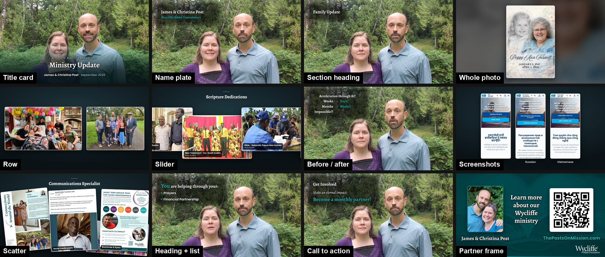

# Ministry Video Toolkit

Turn a talking-head recording and a written script into a finished ministry
update video: photos, headings and lists timed to your words, a music bed, a
closing frame with your photo, web address and QR code, and a YouTube
thumbnail.

It is built for missionaries and ministry staff, and was made for Wycliffe and
SIL ministry updates, but nothing in it is tied to one organisation or one
video. The editing judgement — where to cut, how long text must stay up, how to
keep graphics off people's faces — is written down in [skills](#the-skills) so
the result comes out the same way every time.



*The example: a real, published ministry update, made with this toolkit. Its
footage, photos, script and beat plan are all included, so your first render
reproduces it, and you can see exactly how each moment was built. See
[examples/example-script.md](examples/example-script.md) for the script it was
made from.*

---

## Get started

**[SETUP.md](SETUP.md)** walks you through installing everything and rendering
the example video. Allow about an hour, most of it waiting for installs, the
example's download and its first render.

Already set up? From the `remotion/` folder:

```bash
npm run doctor                  # is everything in place?
npm run studio                  # preview in your browser
npm run render -- _example      # render the example to out/Example.mp4
```

---

## Two ways to use it

**With Claude Code (recommended).** Open Claude Code in this folder and
describe what you want: *"Here's my recording and my Notion script. Make the
video."* The skills in `.claude/skills/` tell Claude how to trim the footage,
plan the graphics, build the closing frame, render, and check the result for
the problems renders actually have.

**By hand.** Everything is plain files and npm commands. The steps are below;
the skills are worth reading either way, because they explain *why*.

---

## What it can make

Each piece of a video is a **beat**: a graphic that appears for a stretch of
the recording.

| Beat | What it looks like | Use it for |
|---|---|---|
| Title card (`opening`) | The footage's first frame, frozen, with your title over it. Then the picture starts moving | Opening |
| Heading (`heading`) | A short label upper left, over the live shot, with an optional subtitle or bullet list | Naming each section or speaker |
| Takeover (`cover`) | One photo, full screen, slowly zooming | A landscape photo worth the whole frame |
| Whole photo (`blur`) | The photo shown complete over a blurred copy of itself | Portraits, or anything with words on it that must not be cropped |
| Row (`row`) | 2–4 images side by side, each at its own shape | Comparing things, such as screenshots |
| Slider (`slider`) | Cards drifting across the screen | A run of 5–10 captioned photos |
| Scatter (`scatter`) | Photos dropping onto a pile, one at a time | A list you read out, each photo on its own phrase |
| Before / after (`compare`) | Two columns, each side appearing on its own word | "Used to take weeks, now days" |
| Thank you (`thankyou`) | A small brand-coloured card beside you | A moment, not information |
| Call to action (`quote`) | Your ask, beside you, over the live shot | The ask, while you keep talking |
| Partner frame (`ending`) | Photo, name, web address and QR code | The close, held long enough to scan |
| Thumbnail | A separate 1280×720 image | YouTube |

[examples/example-script.md](examples/example-script.md) is the example
video's real script, with a note under each part saying which beat it became,
and a list of what was added while editing.

---

## Making your own video

From the `remotion/` folder:

1. **Start a project.** `npm run new -- my-video` copies the example into
   `src/projects/my-video/`. The folder name is also its name in the Studio and
   in every command. It starts with the example's footage, photos and beat plan,
   plus placeholder titles and end frame, so it renders straight away and you
   can replace things one at a time. Your project folders are git-ignored, so
   your video's details stay on your computer.
2. **Point it at your recording.** In `src/projects/my-video/project.json`, set
   `footagePrep.source` to your camera file, and list the `segments` to keep
   (the `footage-prep` skill explains how to choose them). A relative path is
   read from the `remotion/` folder; in JSON, write Windows paths with forward
   slashes (`"C:/Videos/update.mp4"`). Then: `npm run footage -- my-video`
3. **Get a transcript.** `npm run transcribe -- my-video` writes word-by-word
   timings, so graphics can land on the right words. It needs a Whisper API key
   ([SETUP.md](SETUP.md#optional-a-transcription-key)).
4. **Plan the beats.** Edit `beats.ts`: which graphic appears, and when. Times
   are seconds into your **footage**, read off the transcript. (`npm run still`
   takes seconds into the finished video instead, and prints both.)
5. **Set the titles and end frame.** `titleCard` and `thumbnail` in
   `project.json`; your photo, name, web address and QR code in `partner.ts`.
6. **Measure where you are standing.** Set `overlaySafeArea` in `project.json`
   so headings never darken anyone's face (the `beat-library` skill explains
   how).
7. **Preview, render, check.** `npm run studio`, then
   `npm run render -- my-video`, then go through the `review` skill, then
   send it for review on a `review-page` (the script itself is approved earlier,
   on a `storyboard` page).
8. **Make the thumbnail.** `npm run still -- my-video thumbnail` writes
   `out/my-video-Thumbnail.png`. Save it next to the finished video.

**Where your files go** (all git-ignored, so nothing private ends up in the
repository):

| What | Where | Referred to as |
|---|---|---|
| Photos | `remotion/public/images/my-video/` | `images/my-video/photo.jpg` in `beats.ts` |
| Music | `remotion/public/audio/` | `"music": { "src": "audio/my-music.m4a" }` in `project.json`. See [docs/finding-music.md](docs/finding-music.md) for free music you're allowed to use |
| Cut footage, title still | `remotion/public/base/` | written by `npm run footage` |
| Renders and stills | `remotion/out/` | |

A new project starts out using the example's photos and stand-in music, so
replace those paths as you add your own. To hear a music change without
rendering any frames: `npm run render -- my-video --audio-only` writes
`out/my-video-mix.wav`.

**Keeping your own project under version control.** Project folders are
git-ignored here so nobody's video ends up in the shared toolkit. To track a
video in your own repository, keep it in a separate repo and copy or link its
folder into `src/projects/`, or, in your own fork, add a line like
`!remotion/src/projects/my-video/` to `.gitignore`. Leave photos and footage
out either way; they belong with the video files, not in git.

---

## Commands

All run from `remotion/`. `<project>` is a folder name under `src/projects/`.

| Command | What it does |
|---|---|
| `npm run doctor` | Checks your tools and every project, and says how to fix anything missing |
| `npm run new -- <name>` | Starts a new project from the example |
| `npm run example:media` | Downloads the example video's footage and photos (about 80 MB) |
| `npm run footage -- <project>` | Cuts the recording, writes the title-card still, records the real length |
| `npm run transcribe -- <project>` | Word-level transcript of the footage |
| `npm run studio` | Preview in the browser: scrub, inspect, no rendering |
| `npm run still -- <project> <thumbnail\|endframe\|seconds> [file]` | Render one frame to a PNG |
| `npm run render -- <project> [file]` | Render the finished mp4 (frames are kept in `out/frames-<id>/` for `--skip-frames`; delete them when done) |
| `npm run typecheck` | Check the TypeScript |

> **Use `npm run render`, not `npx remotion render`.** On Windows machines with
> Smart App Control turned on, Remotion's own encoder is blocked and the render
> fails with no explanation. The render script uses your installed ffmpeg
> instead and works everywhere. See [docs/gotchas.md](docs/gotchas.md).

---

## The skills

In `.claude/skills/`. Claude Code reads them automatically when it is opened in
this folder; they are also plain Markdown, worth reading yourself.

| Skill | Covers |
|---|---|
| `footage-prep` | Trimming the opening hold and teleprompter pauses; where it is safe to cut |
| `storyboard` | The storyboard page a reviewer approves before filming or rendering: a picture beside each line, editable wording, notes, Approve |
| `script-to-beats` | Turning a script with images into a timed beat plan |
| `beat-library` | Which beat suits which content, card sizes, headings, read time, keeping text off faces |
| `partner-frame` | The closing frame: cropping the photo, checking the QR code, contrast |
| `render` | Rendering and the audio mix |
| `review` | Checking a render: flashes at cuts, audio clicks, sync, legibility, QR scanning |
| `review-page` | The page a reviewer watches a version on: notes per sentence, notes pinned to a spot on the picture, what changed, Looks good |
| `thumbnail` | The YouTube thumbnail |

[docs/finding-music.md](docs/finding-music.md) covers free places to get music
and what their licences allow.

[docs/gotchas.md](docs/gotchas.md) lists four bugs that produce a wrong video
with no error message. Read it once.

---

## Layout

```
.claude/skills/        the editing judgement
docs/                  gotchas, images for this README
examples/              an example script
remotion/
  scripts/             the npm commands above
  src/lib/             the beat engine, project config, brand colours, fonts
  src/components/      one file per beat type
  src/projects/        one folder per video, found automatically; only _example is tracked
  public/_example/     placeholders for new projects; the example's media downloads to media/
  public/fonts/        Alegreya and Poppins, with their licences
  public/brand/        organisation assets
```

Each video's recording, photos and renders stay out of the repository
(`public/base/`, `public/images/`, `public/audio/` and `out/` are git-ignored).

---

## Licences

- **This toolkit's own code and docs:** MIT — see [LICENSE](LICENSE).
- **Remotion**, the video framework this is built on, has its own licence. It is
  free for individuals, for non-profit organisations, and for companies of up
  to three people; larger for-profit companies need a company licence. Check
  [remotion.dev/license](https://www.remotion.dev/license) for your situation.
- **Fonts:** Alegreya and Poppins are under the SIL Open Font License; the
  licence texts are in `remotion/public/fonts/`.
- **The example's footage and photos** are a real video's, not covered by the
  MIT licence. See [examples/MEDIA-NOTICE.md](examples/MEDIA-NOTICE.md).
- **Logos** in `remotion/public/brand/` belong to their organisations. Use them
  only as those organisations' brand guidelines allow.
