# Example script

This is the real script for the example video: James and Christina Post's
September 2026 ministry update with Wycliffe Bible Translators. It was written
in Notion, exactly as below, with the images placed where they belong and a few
bracketed markers saying how to show them. The finished video is what the
example project ([`remotion/src/projects/_example/`](../remotion/src/projects/_example/))
renders.

Under each part, a note says what it became in the beat plan,
[`beats.ts`](../remotion/src/projects/_example/beats.ts). Some of the video's
graphics aren't in the script at all: they were added while editing, by asking
for them. Those are listed at the end, because knowing what you can ask for is
half the point.

**How the script is marked up:**

1. **An image goes with the paragraph that comes after it.** It appears as those
   words are spoken.
2. **A bracketed note is an instruction**, written plainly: `[Slider: Title]`,
   `[Insert images at appropriate times with script]`.
3. **`[video]` means "on camera here".** Thank-yous and asks should be on camera.

If you use Claude Code, hand it a script like this and ask it to make the video;
the `script-to-beats` skill does the translation. Working by hand, nothing reads
the script automatically: use it as your guide and write the beats into
`beats.ts` yourself.

> **Two differences from the original.** The example replaces a large family
> group photo with the photo of Charlie below. And the communications section
> shows the four samples used in the finished video, which were swapped in after
> the script was written.

---

`[video]`

Hey there, it's James and Christina, **your** missionaries with Wycliffe Bible
Translators. The last several months have been full, and it's exciting to be
able to share what God has been doing in our family, our Wycliffe ministry, and
in Bible translation around the world!

> **Became:** the title card (from `titleCard` in `project.json`), then a name
> plate, upper left, while they introduce themselves.

First, a family update:

After six months of in‑home hospice care, Christina's mom went to be with the
Lord on April 1st.

> **Became:** a "Family Update" heading, then the memorial card shown whole over
> a blurred copy of itself (`blur`). It's a portrait with typeset text at the
> bottom, so it must never be cropped.

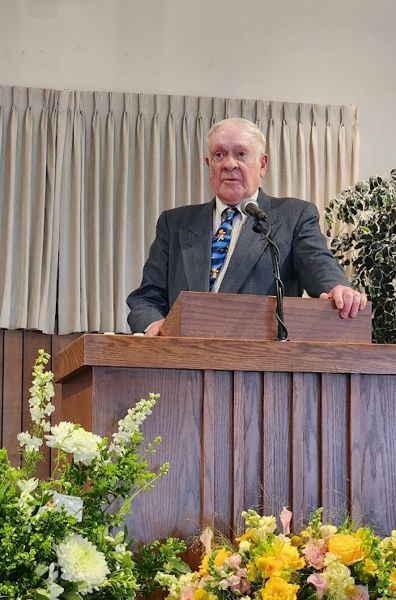

We had a really beautiful celebration of life service and have spent a lot of
time with family in these last months.

> **Became:** a second `blur` beat, captioned "Celebration of life service". It
> starts exactly where the first one ends, so nothing flashes between them.

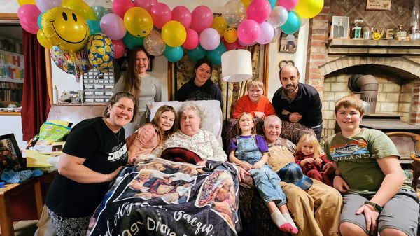 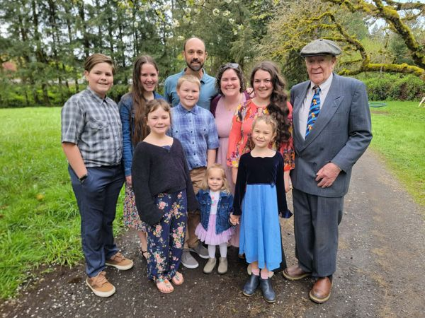

We're grateful for the time that we were able to spend with her before she
passed and have been heavily involved with the transitions that have come
afterwards.

> **Became:** a `row`: two photos side by side, placed as two columns in Notion,
> each shown at its own shape.

`[video]`

Thank you for your prayers for us and our family during this season.

There is lots to update you on in our Wycliffe ministry. First, this is a very
exciting time to be involved in Bible translation!

> **Became:** back on camera for the thank-you, then a "Ministry Update / Bible
> Translation Progress!" heading.

`[Slider: Scripture Dedications]`

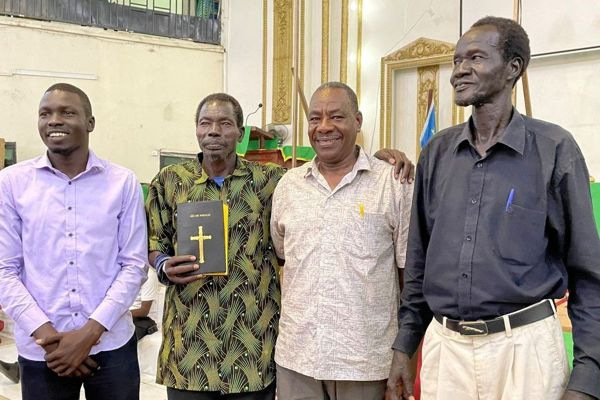 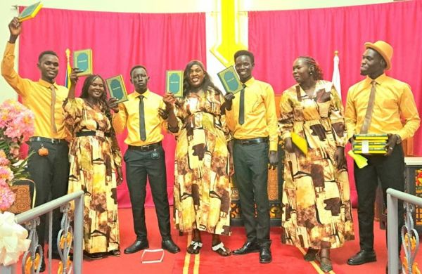 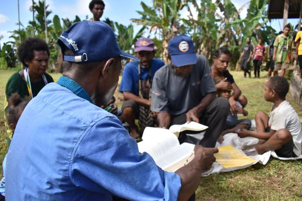 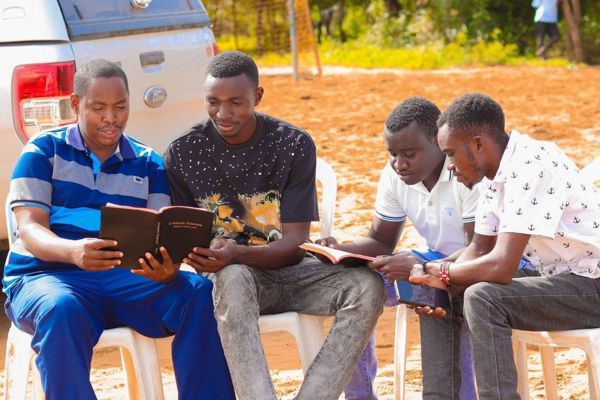 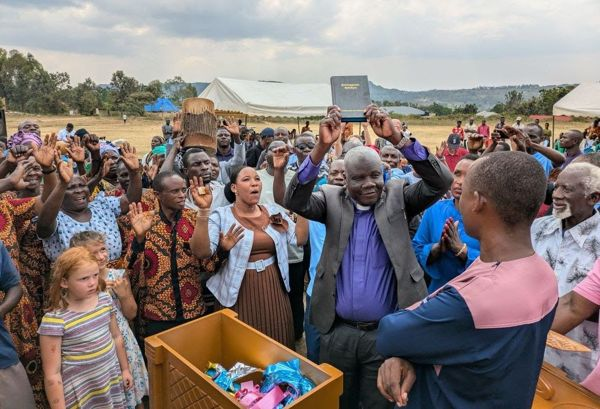

Through partnerships around the world, more and more people are receiving God's
Word in their own language! Earlier this year marked the 800th language to
receive a complete Bible! This means that approximately 6.2 billion people in 800
language communities now have access to the *complete Word of God.*

> **Became:** a `slider`. In Notion each photo's alt text held its credit
> ("Wycliffe", "SIL PNG"), and its file name held the Scripture, language and
> country, which became its caption, e.g. "Bible - Dinka Cam, South Sudan" with
> "Photo: Wycliffe" beneath.

`[video]`

As I continue to support the technology that helps make Bible translation and
linguistic work possible, AI has greatly multiplied and accelerated what I'm able
to do on a daily basis. What used to take weeks or months (or I couldn't even
do…) can now be done in days or weeks, with better results!

> **Became:** a "James Post / Language Technology Consultant" name plate, then
> a before/after (`compare`): *Weeks → Days! · Months → Weeks! · Impossible?! →
> Possible!*, each side appearing on its own word.

Through using AI and modern technology, we've been able to make vital software
resources more accessible for people around the world.

  

Whether it's instantly translating a global website into dozens of languages

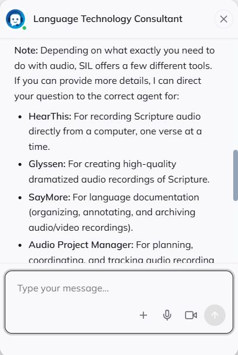 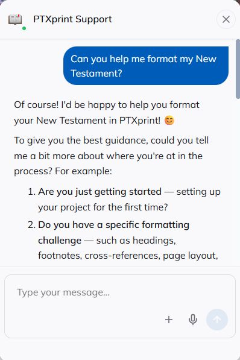 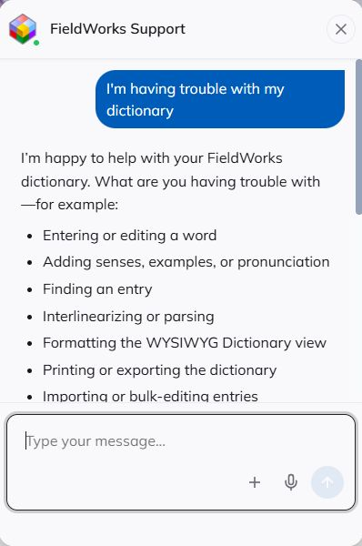

or giving people 24/7 access to AI chatbots in almost 100 different languages,

> **Became:** two `row` beats, one per phrase. Screenshots are sized to land near
> their real size, because blowing a small screenshot up makes it look soft.

using AI is like having superpowers.

> **Became:** a `blur` beat, landing just before the line so the joke is on
> screen when it's said.

`[video]`

We're able to more effectively advance the cause of Bible translation and
linguistic work around the world!

In April, I started a new assignment with Wycliffe, working as a Communications
Specialist! This means I get to use my writing and design skills to help advance
the work of Bible translation.

> **Became:** a "Christina Post / Communications Specialist" name plate as she
> takes over.

`[Scatter]` `[Insert images at appropriate times with script]`

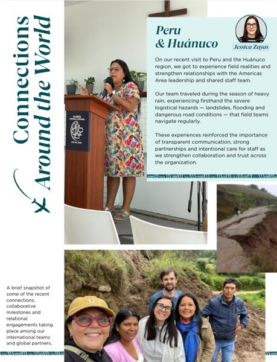 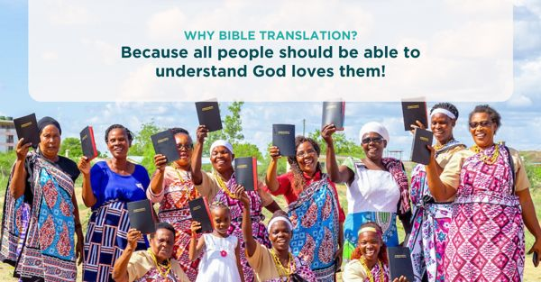 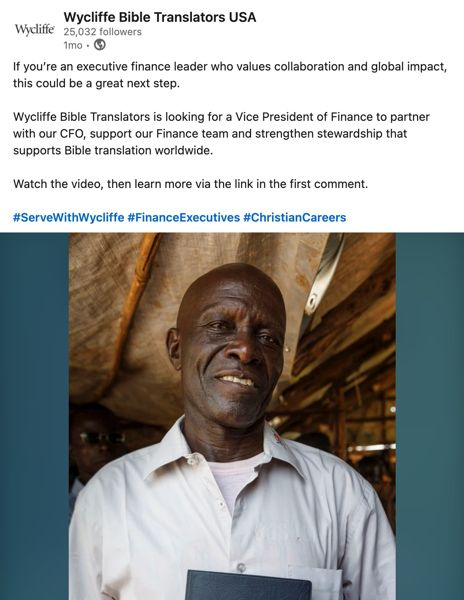 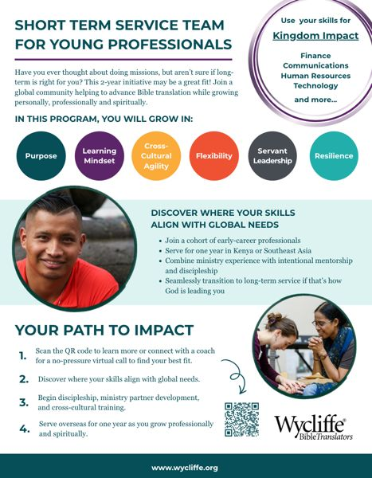

Writing travel reports and newsletters, editing internal communications, doing
social media posts and video scripts, and designing brochures and flyers, these
are some examples of things I get to do to support the work of Bible
translation.

> **Became:** a `scatter`. Each card lands on the phrase it illustrates, timed
> from a transcript, and they're about 2.3 seconds or more apart so each caption
> can be read before the next card covers it.

Translation work is also accelerating!

`[Scatter: Scripture Dedications]`

 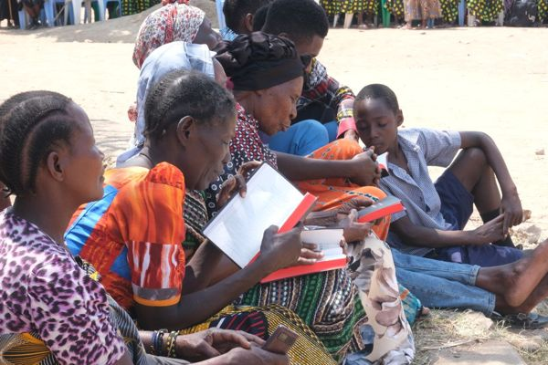 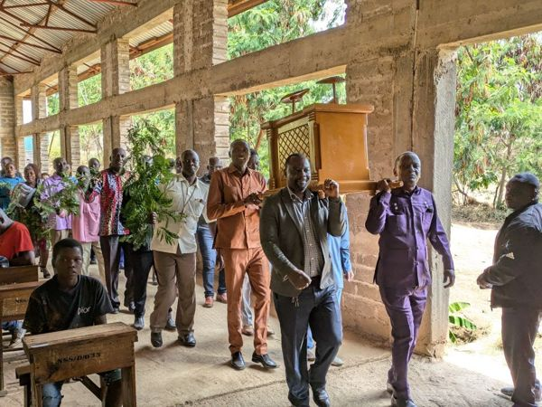 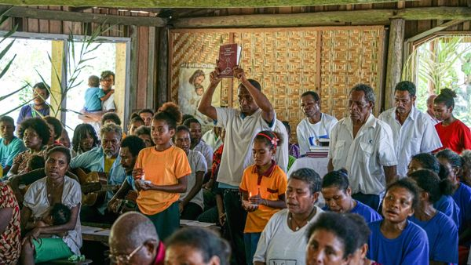 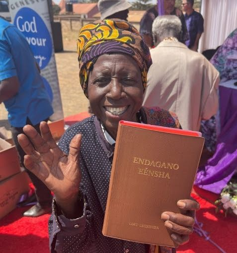 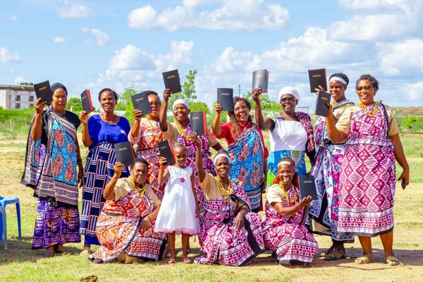

By 2033, we expect that every single language of the world will have access to
at least some portion of God's Word! What a pivotal time to be involved in Bible
translation! You are helping make this happen through your prayers and financial
partnership.

> **Became:** a second `scatter`, then, back on the live shot, a heading with
> bullets: *You are helping through your: · Prayers · Financial Partnership*.

`[video]`

On behalf of dozens of language groups who have recently received God's Word in
their language, thank you!

If you'd like to become more involved in supporting the work of our Wycliffe
ministry, we're asking the Lord for new and increased monthly financial partners.
Would you prayerfully consider making an eternal impact by becoming a monthly
partner?

> **Became:** a "Thank You!" card beside her on "thank you!", then the call to
> action (`quote`): "Get Involved" first, then *Make an eternal impact: Become a
> monthly partner!* on the words themselves, both held together.

`[keep video through the end, then show the QR code page]`

May God bless you and pour out His favor on you as you seek Him and His Kingdom.
God bless!

`[End frame]`

James & Christina Post
ThePostsOnMission.com

  

> **Became:** the closing partner frame (`ending`), set in
> [`partner.ts`](../remotion/src/projects/_example/partner.ts): the photo
> cropped to the card, the QR code at a size proven to scan, and the image
> captioned "Background" behind it all.

---

## Added while editing

These weren't in the script. They were asked for while reviewing drafts of the
video, and are the kind of thing worth asking for in yours:

- **Section headings** (upper left) for each part: Family Update, Ministry
  Update, and each speaker's name and role as they take over.
- **The before/after** on "weeks or months… days or weeks": seen, it lands far
  harder than heard.
- **The bullet list** on "your prayers and financial partnership".
- **The Thank You! card** and the **call to action** beside the speaker.
- **Timing fixes**: holding a heading longer so it can be read, landing a photo
  on a later word so a face is on screen for a hard sentence, trimming the long
  pauses where the teleprompter was catching up.

## Writing your own

- **Write it the way you'll say it.** The words on the page are the words in the
  video.
- **Put images where they belong in the story.** Each appears as you say the
  words after it.
- **Caption what the picture can't say:** a place, a language, a person's role.
- **Credit photos you didn't take**, in the image's alt text.
- **Ask before using photos of people who aren't you or your family**,
  especially screenshots of meetings and video calls.
- **Check your web address** in the end frame. It's the line people type in by
  hand.
